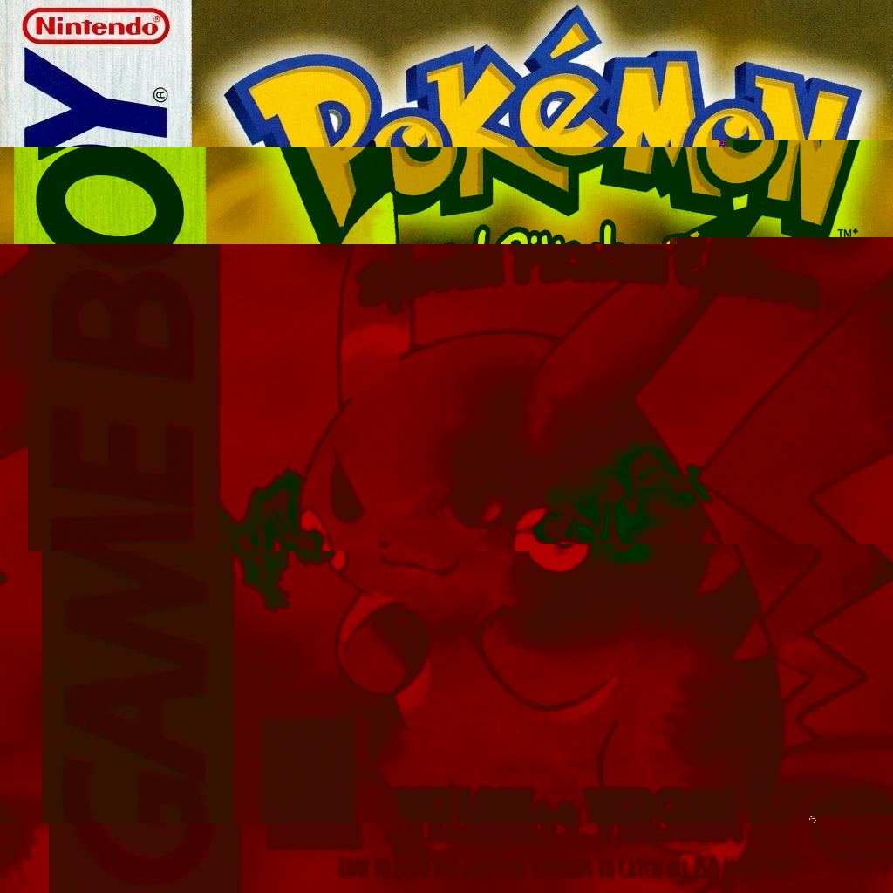
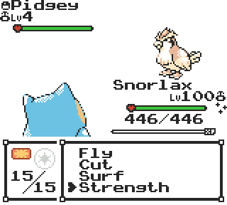
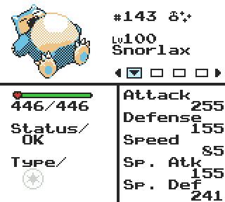
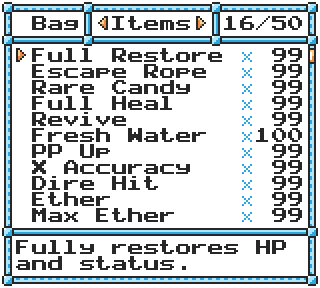
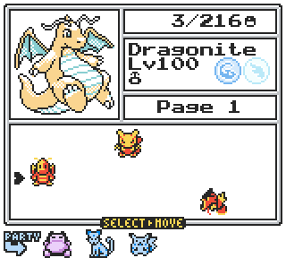
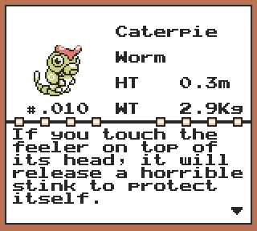
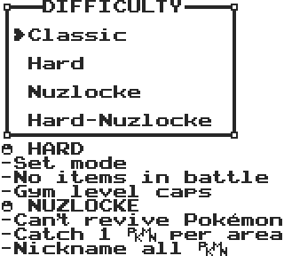
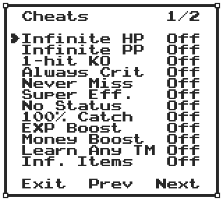
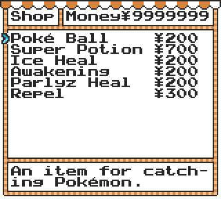

# Pokémon Yellow++

  

**The classic Pokémon Yellow experience but modernized.**

Rediscover Kanto with modern battle mechanics, redesigned interfaces, new challenges, and countless quality-of-life improvements — while preserving the original adventure.

 

📖 **[Explore the Wiki →](https://github.com/mirko93s/yellowplusplus/wiki)**

## Features

### ⚔️ Modern Battle Mechanics
Physical/Special split, separate Sp. Atk/Def, Gen 7+ critical hits, updated moves and mechanics, plus an enhanced battle HUD with colored type icons, effectiveness indicators, and detailed move information.

### 🎮 Redesigned Interfaces
Brand-new battle HUD, Gen 2-inspired status screen, Gen 2 Bag with pockets, expanded Pokédex, fully graphical Bill's PC with Gen 3-style Pokémon storage.

### 🗺️ Expanded Kanto
All 151 Pokémon obtainable (living dex), more diverse wild encounters, rebalanced and more challenging trainers, new Pokémon sprites, and challenging Gym Leader and Pokémon League rematches.

### 🏆 Game Modes & Randomizer
HARD and NUZLOCKE modes with an optional Dupe Clause, plus a built-in wild Pokémon randomizer supporting custom shareable seeds.

### 🎨 Pokémon & Customization
Shiny Pokémon, player and Pokémon genders, unique minisprites, selectable fonts and text box frames, and multiple color correction modes.

### ⚡ Quality of Life
Running shoes, reusable TMs, move relearner and deleter, improved item management, built-in cheats menu, numerous og bugs fixed, and much more.

**...and much more!**

These are just some of the highlights. Check out the **[full feature list on the Wiki](https://github.com/mirko93s/yellowplusplus/wiki)** for everything Pokémon Yellow++ has to offer.

## Screenshots

| **Enhanced Battle HUD** | **Pokémon Status** | **Bag with Pockets** | **Bill’s PC** |
|:---:|:---:|:---:|:---:|
|  |  |  |  |
| **Expanded Pokédex** | **Game Modes** | **Cheats Menu** | **Revamped Shop** |
|  |  |  |  |

---

## 📣 Credits

Pokémon Yellow++ wouldn't have been possible without the amazing work of the Pokémon ROM hacking community.  
Special thanks to everyone who contributed code, artwork, tools, tutorials, and inspiration.

**[Full Credits & Acknowledgments](CREDITS.md)**
